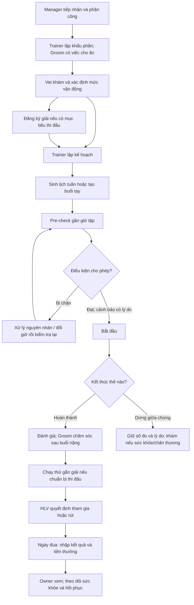

# Flow hiện tại: tiếp nhận, huấn luyện, chăm sóc và thi đấu

Cập nhật 11/10/2026, đối chiếu route/controller và UI tại code `654ae43` cùng thay đổi local.

Ghi hoàn thành việc và trừ kho dùng chung transaction. Kết quả giải, tiền thưởng và
thành tích cũng dùng chung transaction; liên kết theo `raceEntry`, không gộp theo
tên giải. MongoDB cần replica set. Xem [TEST_REPORT.md](TEST_REPORT.md) để biết
phần đã chạy tự động; checklist test tay vẫn ghi riêng.
Mô tả hành vi đang triển khai; **chưa xác nhận lại bằng E2E trong phiên này**.
Dùng [TEST_CHECKLIST.md](TEST_CHECKLIST.md) để ghi kết quả khi test.

## 1. Ai dùng phần nào?

| Vai trò | Nơi dùng | Trách nhiệm |
|---|---|---|
| Club Manager | Web | Duyệt tài khoản, tiếp nhận/phân công ngựa, chuồng/kho, thu chi/báo cáo |
| Head Trainer (HLV) | Web | Khẩu phần, kế hoạch, lịch, pre-check, chạy/đánh giá buổi, quyết định dự giải |
| Veterinarian (bác sĩ) | Web | Khám, điều trị/kê thuốc, mức vận động, xử lý sự cố |
| Groom (NV chăm sóc) | Mobile Expo; web test tạm trong dev | Cho ăn/thuốc/chăm sóc, ghi quan sát, báo sự cố, đề xuất vật tư |
| Horse Owner | Web | Theo dõi ngựa của mình, sức khỏe/lịch/kết quả, nhận xét HLV, thu chi |

Trainer thấy ngựa được phân công. Vet có phạm vi theo phân công và luồng yêu cầu
khám/hồ sơ khám. Groom làm việc được giao. Owner chỉ thấy ngựa thuộc mình.
Tự đăng ký chưa cho phép đăng nhập: Manager phải duyệt và kích hoạt.

## 2. Sơ đồ luồng

Đây là thứ tự dễ dùng khi test; khẩu phần và khám có thể chuẩn bị song song.
Giải mục tiêu là tùy chọn. Checklist dẫn bước tiếp theo, nhưng không thay thế
kiểm tra điều kiện thật khi tạo buổi, pre-check và bắt đầu.

## 3. Tiếp nhận và phân công

**Manager — Danh mục Ngựa (`/horses`), Chuồng trại & NV chăm sóc (`/admin/stables`).**

1. Tạo ngựa; chọn chủ sở hữu, HLV và bác sĩ phụ trách.
2. Xếp chuồng/khu và Groom chăm sóc.
3. Xem cột/thẻ **Bước tiếp theo** và checklist trong hồ sơ ngựa.

Checklist tổng hợp chủ, HLV, Vet, chuồng/Groom, khẩu phần, hồ sơ khám, hạn chế
y tế, giải tùy chọn, kế hoạch và lịch. `healthStatus = eligible` mặc định lúc tạo
ngựa không được coi là đã khám; cần hồ sơ do bác sĩ lập.

Nếu ngựa khóa tập, chấn thương/cách ly hoặc chờ đánh giá trở lại tập, bước tiếp
theo chuyển về bác sĩ. API: `GET /horses/:id/checklist`.

## 4. Khẩu phần và việc chăm sóc hằng ngày

**HLV — Chuồng trại & Chăm sóc (`/stable/tasks`), tab Khẩu phần ăn.**

1. Lập khẩu phần từng bữa: giờ, mặt hàng thức ăn, lượng mỗi bữa.
2. Chọn mặt hàng kho để việc cho ăn có dữ liệu trừ tồn. Khẩu phần cũ chỉ có chữ
   mô tả, không liên kết mặt hàng, không đủ dữ liệu để tự trừ kho.
3. Mỗi ngựa có một khẩu phần cho mỗi loại bữa; sửa khẩu phần đã có thay vì tạo trùng.

Server tự tạo việc cho ăn từ khẩu phần và phân công chăm sóc. Sửa giờ/menu đồng
bộ việc còn mở hôm nay; việc đã qua khung giờ giữ như lịch sử. HLV có thể giao
việc thủ công kèm giờ; loại **Khác** cần nội dung.

**Groom — Cho ăn / Việc / Thêm → Thuốc & y lệnh.**

Test trên máy tính: `npm --prefix mobile run web` mở chính app này trên trình duyệt,
cùng tài khoản/API. Web quản lý không có màn hình Groom.

- Xem việc theo ngày/ngựa; thực hiện rồi ghi nhận, có thể kèm quan sát ăn uống,
  nước uống, phân và ghi chú.
- Bữa ăn có khung mặc định từ 60 phút trước đến 4 giờ sau giờ xếp, không kéo
  qua cuối ngày. Thuốc/việc theo dõi có giờ cũng xét khung thực hiện.
- Cho ăn, thuốc, theo dõi đã quá hạn không được tick bù như vừa thực hiện.
  Việc khác có thể cho ghi muộn và hiện trễ hạn theo `timing` server trả về.
- Thiếu vật tư liên kết: server từ chối hoàn thành; Groom gửi đề xuất bổ sung.
- Không làm được: ghi lý do bằng thao tác tương ứng, không đánh dấu đã làm.

API: `/feeding`, `/stable/tasks`, `/stable/my-care-plan`.

## 5. Bác sĩ đánh giá và điều trị

**Vet — Sức Khỏe Chiến Mã, Phác Đồ & Khóa Tập, Kê Đơn Thuốc.**

1. Khám từ hồ sơ ngựa/hàng chờ yêu cầu khám; ghi chỉ số, kết luận, ảnh/PDF nếu cần.
   Yêu cầu khám có thể được **nhận + hẹn giờ** (vẫn mở tới khi có hồ sơ khám) hoặc
   **từ chối kèm lý do**; người yêu cầu được báo (`PATCH /health/exam-requests/:id` `action`).
   Tiêm phòng/tẩy giun/đóng móng ghi từng lần (`/horses/:id/care-events`, vắc-xin/thuốc,
   số lô, liều); `nextDue` dời lịch nhắc. Hiện trên dòng thời gian của ngựa.
2. Chọn **Mức vận động được phép** (`clearedLevel`) trong hồ sơ khám.
3. Nếu cần điều trị, lập phác đồ/y lệnh: mức tập, thuốc, lượng dùng, giờ/liều.
   Thuốc liên kết kho được trừ khi Groom thực hiện liều, không phải lúc kê đơn.

| Mức | Ý nghĩa |
|---|---|
| `none` | Không được tập |
| `light` | Tập nhẹ |
| `moderate` | Tối đa cường độ vừa |
| `high` | Không hạn chế mức tập bởi clearance |

Clearance lấy mức chặt nhất từ điều trị đang chạy, điều trị đã kết thúc nhưng
chưa được đánh giá trở lại và đánh giá gần nhất. **Kết thúc điều trị không tự
cho tập lại.** Bác sĩ cần khám và ghi mức cho phép mới.

Khóa/hạ mức tập có thể hủy booking vượt mức; buổi đang chạy chịu tác động của
hạn chế y tế sẽ dừng giữa chừng, giữ số đo. Buổi bị chặn cần kiểm tra lại khi điều
kiện thay đổi. Không tự khôi phục booking đã hủy: HLV xem lại lịch, sinh/tạo buổi
mới. Giải đã xác nhận có thể bị đánh dấu cần xem lại.

API: `/health/records`, `/health/treatments`, `/health/exam-requests`, `/health/clearances`.

## 6. Đăng ký giải và lập kế hoạch

**HLV — Đăng ký Giải đua (`/races`).**

- Nếu hướng tới thi đấu, tạo lượt đăng ký: ngựa, tên giải, ngày, cự ly, trường
  đua/mặt sân. Ngày mới không ở quá khứ; cự ly bắt buộc 400–6000 m.
- Lượt mới ở `registered` (Đã đăng ký), chưa phải quyết định cho ngựa thi đấu.
- Bấm **Lập kế hoạch** trên dòng giải để mở wizard với sẵn ngựa và giải mục tiêu.

**HLV — Kế hoạch Huấn luyện (`/training/plans`).**

1. Có thể lập kế hoạch không có giải bằng **Lập kế hoạch mới**.
2. Chọn ngày bắt đầu, giai đoạn, tuần mẫu, loại bài, giờ sáng/chiều. Nếu có giải,
   xem gợi ý theo ngày/cự ly và cảnh báo trước khi áp dụng.
3. Mỗi ngựa chỉ có một kế hoạch `active`; xử lý kế hoạch hiện tại trước khi
   kích hoạt kế hoạch khác.
4. Áp dụng chỉ lưu chu kỳ và mẫu, **chưa sinh buổi cụ thể**.

**HLV — Buổi Tập & Đánh giá (`/training/sessions`), lịch tuần.**

- Bấm **Sinh lịch tuần đầu tiên** hoặc sinh tuần từ thẻ kế hoạch/lịch tuần.
- Generator bỏ giờ đã qua, slot có buổi và ngày đua. Với kế hoạch có giải, trial
  được xếp tại ngày đua trừ 8 ngày và gắn lượt đăng ký mục tiêu, khi sinh tuần đó.
- Ngựa khóa tập không sinh lịch; hồi phục có thể giảm bài theo clearance.
- Có thể tạo buổi tay. Buổi **Chạy thử** cần chọn lượt đăng ký của đúng ngựa,
  ngày chạy trước ngày đua; cự ly lấy theo giải.

Loại bài: đi bộ/chạy kiệu (`walk`), phi chậm (`canter`), tập dốc (`hill`), phi nhanh
(`breeze`), chạy thử (`trial`). Policy chiều chỉ tập nhẹ bật: từ 12:00 chỉ cho
`walk`/`canter`; `canter` có cường độ mặc định `moderate` trong code. Quy tắc áp
dụng cả tạo tay, sinh lịch, đổi giờ và xếp lại.

## 7. Chạy một buổi tập

**HLV — Buổi Tập & Đánh giá, chọn buổi trên lịch tuần/bảng danh sách.**

1. **Kiểm tra sẵn sàng**: mặc định mở từ 60 phút trước đến 30 phút sau giờ xếp.
   HLV xác nhận đã trực tiếp kiểm tra ngựa; có thể nhập thân nhiệt/ghi chú.
2. Server xét y tế, giấy khám còn hiệu lực, dinh dưỡng, người chăm sóc. Pre-check xét bữa ăn
   theo giờ tập dự kiến (không sớm hơn hiện tại); start xét lại theo hiện tại.
3. Chặn cứng: xử lý nguyên nhân rồi **Kiểm tra lại** hoặc **Đổi giờ**. Sốt từ
   38,6 °C mặc định chặn và gửi yêu cầu khám ưu tiên cao.
4. Cảnh báo vàng cần lý do HLV chấp nhận, lưu audit. Lý do có thể giữ trong thời
   hạn nếu cảnh báo vẫn tương ứng; điều kiện mới vẫn được kiểm tra lại.
5. Pre-check đạt → `ready`. **Bắt đầu** → `in_progress`, server ghi giờ thật.
   Pre-check có hiệu lực mặc định 2 giờ; start vẫn kiểm lại điều kiện.
6. Theo dõi số đo realtime nếu server bật simulator.
7. **Kết thúc** khi hoàn thành hoặc **Dừng giữa chừng** với nhóm nguyên nhân/lý do.
   Simulator cũng tự hoàn thành khi đạt cự ly/thời lượng mô phỏng.
8. Buổi `completed`: **Đánh giá** (điểm/nhận xét/link video) → `evaluated`. Có thể
   sửa đánh giá, audit lưu thay đổi; không dùng đánh giá để sửa số đo gốc.

### Trạng thái và thao tác

| Trạng thái | Ý nghĩa / thao tác tiếp theo |
|---|---|
| `scheduled` | Đã xếp, chưa chạy; kiểm tra, đổi giờ hoặc hủy booking |
| `blocked` | Chưa đạt điều kiện; xử lý nguyên nhân, kiểm tra lại/đổi giờ |
| `ready` | Pre-check đạt; bắt đầu trong thời hạn hoặc đổi giờ/hủy |
| `in_progress` | Đang chạy; kết thúc hoặc dừng giữa chừng |
| `completed` | Đã chạy xong; đánh giá |
| `evaluated` | Đã đánh giá; có thể sửa đánh giá |
| `aborted` | Dừng giữa chừng, giữ số đo/lý do; không tiếp tục chạy bản ghi này |
| `cancelled` | Booking chưa chạy đã hủy; không dùng cho buổi đang chạy |
| `missed` | Chưa chạy, quá cửa sổ/thời hạn; xếp lại bằng buổi mới |

Watcher kiểm tra mỗi 5 phút; buổi chưa đạt kiểm tra quá cửa +30 phút có thể thành
`missed`, còn buổi `ready` được giữ khi pre-check còn hạn. `missed` không nhất
thiết hiện ngay đúng phút hết hạn.
Xếp lại giữ buổi cũ làm lịch sử. Đổi giờ buổi chưa chạy đưa về `scheduled`, bỏ
hiệu lực pre-check cũ.

### Giờ thật, mô phỏng và chăm sóc sau tập

- `actualStartAt`, `actualEndAt`, `actualDurationSec`: đồng hồ thật trên server.
- `simulatedWorkSec`: thời gian vận động simulator chạy nén; không phải số đo
  thiết bị thật đã được tích hợp.
- Buổi nặng hoàn thành (cường độ cao hoặc mô phỏng thi đấu) sinh việc ngâm/chườm
  chân và tắm cho Groom phụ trách, mặc định +15/+45 phút từ lúc kết thúc.
- Dừng nhóm `health`/`injury` tự yêu cầu khám và đánh dấu giải xác nhận cần xem lại;
  không đi qua nhánh chăm sóc của buổi hoàn thành.

Tập nặng/chạy thử cần hồ sơ khám phù hợp, còn hạn (mặc định 14 ngày). Bữa thức ăn
tinh vừa ăn dưới 60 phút chặn bài không nhẹ, 60–90 phút cảnh báo; bữa chỉ cỏ khô
cảnh báo theo mốc 60 phút. Tập `light` không bị chặn do vừa ăn. Giá trị thực tế
đọc từ `GET /settings/policy`, không mặc định mọi server giống nhau.

## 8. Chạy thử, quyết định dự giải và kết quả

1. Chạy `trial` qua cùng vòng đời pre-check → start → end → evaluation.
2. Vào **Đăng ký Giải đua**, xem trial gắn đúng lượt đăng ký.
3. **Quyết định dự giải**: tham gia (`confirmed`) hoặc rút (`withdrawn`). Server
   kiểm lại y tế; trial đạt không tự xác nhận tham gia.
4. Chưa có trial hoàn thành thì xác nhận cần lý do ngoại lệ. Trial chưa đạt
   cũng cần lý do vẫn tham gia; rút cần lý do.
5. Sức khỏe đổi sau xác nhận → cần xem lại (`reviewNeeded`); HLV quyết định mới.
   Cờ này không tự thay thế quyết định rút.
6. Từ ngày đua, **Cập nhật kết quả**: thứ hạng/kết quả, thời gian, tiền thưởng.
   Không nhập cho giải tương lai hoặc lượt đã rút.
7. Server chuyển lượt sang `completed`, cập nhật thành tích và khoản thu thưởng
   liên kết. Sửa thưởng qua kết quả giải, không qua sổ thu/chi.

API kết quả cho cả Manager, nhưng web chỉ mở `/races` cho HLV. Nhập kết quả không
tự hoàn tất mọi bước hồi phục: tiếp tục theo dõi sức khỏe, clearance, kế hoạch.

## 9. Kho và tài chính

**Groom — Thêm → Vật tư; Trainer/Vet có quyền đề xuất tương ứng.**

Đề xuất mặt hàng hiện có/mới → Manager mở **Vật tư & Thức ăn** (`/inventory`)
duyệt/từ chối → duyệt thì chờ hàng, tồn chưa tăng → hàng về, **Nhận hàng** trên
đề xuất → tồn tăng, đề xuất `received`. Nhận lại cùng đề xuất bị từ chối.

API còn cho nhập trực tiếp không có `requestId`; mỗi lần là một lần nhập riêng,
không có bảo vệ nhận lại theo đề xuất. Đề xuất cũ đã cộng kho lúc duyệt không được
nhận thêm qua bước mới.

**Manager — Báo cáo Tài chính (`/finance`).** Ghi thu/chi thủ công, xem báo cáo,
tải CSV. Tiền thưởng còn liên kết giải bị chặn sửa/xóa thủ công; nếu giải đã bị
xóa thì Manager có thể dọn khoản còn lại.

**Owner — Chi phí & Doanh thu (`/finance`).** Đọc sổ và tổng hợp tháng/quý ngựa
mình. Trừ kho không tự tạo hóa đơn hoặc tự ghi mọi chi phí thức ăn/thuốc.

## 10. Sự cố, offline và ngừng quản lý

- Groom báo sự cố có mô tả/ảnh → Vet và HLV nhận thông báo → Vet tiếp nhận/kết
  luận. Sự cố còn mở có thể chặn tập và gắn cờ xem lại giải.
- Outbox mobile hỗ trợ complete/not-done/acknowledge/incident. Chờ đồng bộ là
  thay đổi local, chưa phải server xác nhận thành công.
- Complete/not-done gửi `performedAt`, `clientOpId`; server lưu `receivedAt`, xét
  giờ thực hiện, đánh dấu gửi muộn quá 10 phút. Quá 24 giờ hoặc ở tương lai quá
  2 phút bị từ chối; báo HLV/Manager xử lý, chưa có màn ghi bù riêng trong flow.
- Ảnh/file khám lưu GridFS, đọc bằng URL có chữ ký. Incident không có cùng cam kết
  chống lặp `clientOpId` như complete/not-done.
- Manager **Ngừng quản lý**: giữ lịch sử, đóng việc/yêu cầu khám/điều trị còn mở,
  hủy lịch chưa chạy, dừng buổi đang chạy, rút giải tương lai. Ngựa ẩn khỏi danh
  sách làm việc Trainer/Vet; Owner/Manager vẫn tra lịch sử. Đưa ngựa trở lại quản
  lý không tự mở lại bản ghi đã đóng.

## 11. Owner và giới hạn khi test

Owner có Ngựa của tôi, Sức khỏe, Lịch Huấn luyện, Chuồng trại & Chăm sóc, Lịch
Cuộc Đua, Đánh giá HLV, Chi phí & Doanh thu. Thẻ tóm tắt từng ngựa trên Tổng quan
đọc API thật: bước tiếp theo, sức khỏe, buổi/kết quả gần nhất, giải và thu chi.
Số tổng trên đầu dashboard: `GET /horses/owner-overview` (số ngựa, tổng định giá, thành tích
giải, thu chi và buổi tập tháng này so tháng trước); biểu đồ `/reports/training-chart?months=|days=`.
Định giá ngựa (Manager nhập) chỉ Manager và chủ ngựa thấy.

Trên web, Tổng quan của Owner dùng đúng các API này: 4 thẻ (giá trị tài sản, tỷ lệ thắng, buổi tập và thu
tháng này so với tháng trước), biểu đồ theo kỳ (12/6 tháng, 30 ngày, từ đầu năm), lịch sắp tới và bảng chiến
mã. Không còn số liệu hay dòng mẫu; chưa có dữ liệu thì hiện "—" hoặc trạng thái trống. Tab Sức khỏe của hồ
sơ ngựa có lịch sử tiêm phòng/tẩy giun/đóng móng (`GET /horses/:id/care-events`).

Nguồn đối chiếu: `client/src/router/AppRouter.jsx`, menu theo role,
`server/src/modules/`, `server/src/constants/training.js`, `server/src/utils/taskTiming.js`
và `server/src/config/clubPolicy.js`. Mọi API nêu trong file có tiền tố `/api/v1`.
